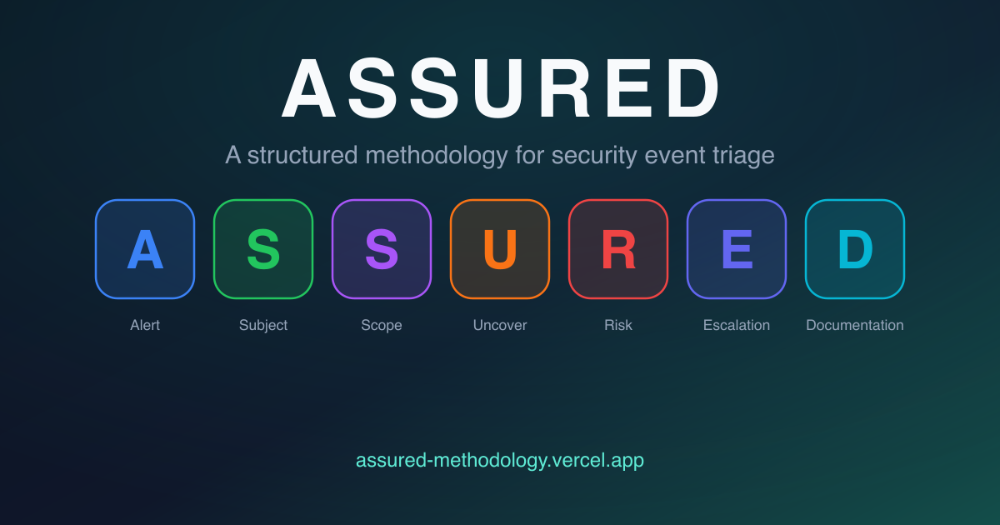

# ASSURED: a methodology for security event triage

> **A structured methodology designed to help security analysts triage, investigate, and document events with clarity, context, and confidence.**

[](CHANGELOG.md)
[](LICENSE)
[](LICENSE-CONTENT)
[](https://assured-methodology.vercel.app)
[](#contributing)

**📖 Live site: [assured-methodology.vercel.app](https://assured-methodology.vercel.app)**



## What is ASSURED?

ASSURED is a methodology for **security event triage**: the work between an alert firing and the decision to close it or escalate it to incident response. Incident-response frameworks such as NIST SP 800-61r3, SANS PICERL and SANS DAIR treat triage as one step in a larger lifecycle and describe it at program level (DAIR names it as its own waypoint, Verify and Triage). ASSURED expands that step into one open, versioned, per-alert workflow, with named phase outputs and a close-or-escalate boundary, for work many analysts otherwise learn informally on the job. See [How ASSURED compares](#how-assured-compares) below, [Where ASSURED sits](https://assured-methodology.vercel.app/docs/positioning/) for the full comparison, and the [standards mapping](https://assured-methodology.vercel.app/docs/standards-mapping/) for where its records meet NIST CSF 2.0 and SP 800-61r3, ISO/IEC 27035-1 and ISO/IEC 27001 A.5.25, and SANS DAIR.

It is written as a teachable course: seven chapters, each with concept pages, a worked example, a quiz, and (except the last) a transition into the next phase.

## The Framework

| Letter | Phase | Anchor question | What it covers |
|--------|-------|-----------------|----------------|
| **A** | Alert | What fired, and why? | Intake beyond detections, how detections work (signature, anomaly, rule, behavioral), validation, alert parsing |
| **S** | Subject | Who is involved? | Entity identification: four dimensions, entity types, non-human identities and cloud roles, behavioral framework, insider analysis |
| **S** | Scope | Where are the lines? | Investigation boundaries: regulatory (with the notification clock card), time, entity, infrastructure, asset and user criticality |
| **U** | Uncover | What does the evidence say? | Evidence gathering: data sources, threat intelligence, MITRE ATT&CK, correlation, tooling, the confidence-labeled timeline |
| **R** | Risk | How bad is it, and how confident are we? | Impact × likelihood (RATM) with analytic confidence recorded beside the cell, the override rules, a priority (P1 to P4) and a recommended move, the two-axis verdict (detection correctness × activity disposition). Risk recommends; the Escalation decision decides |
| **E** | Escalation decision | Close or escalate, and who needs to know? | The documented close as a first-class outcome, the escalation tripwire and criteria, protocols, preserve before you contain, talking to people during triage, the triage-vs-IR boundary, the 9-section handoff packet |
| **D** | Documentation | What did we decide, and what did we learn? | Standards, templates, pitfalls, closure and downstream uses |

Three threaded cases run through every chapter's worked example: a fake invoice page that talks a finance analyst into pasting a PowerShell command into the Run dialog, which escalates to IR; a Cursor IDE alert that turns out to be a benign true positive (the rule fired on exactly what it describes, and the IDE's documented behavior explains it) and closes at triage; and a SaaS-tenant token theft with no endpoint evidence that escalates mid-investigation. A fourth, [Case D](https://assured-methodology.vercel.app/docs/cases/case-d/), has its own page: an identity alert that turns out to be a parser false positive (data), held at P3 on named triggers, handed back by Tier 2 and closed as undetermined. The same methodology produces all four verdicts.

Three themed glossaries support the chapters: **B.A.D.** (Behaviors, Adversaries, Damage: attack techniques, threat actors, campaigns, malware families), **C.A.T.** (Cybersecurity Applications & Tools: named vendor products mapped to the category they belong to), and **C.L.E.A.R.** (Common Lexicon of Essential Analyst References: the core triage vocabulary). Together they define about 1,000 terms, available inline as tooltips (hover, keyboard focus, or tap). A fourth page, **ASSURED terms**, collects the method's own vocabulary, including the verdict crosswalk, and an acronyms index lists every abbreviation the site defines.

## Using ASSURED

- **On shift**: the one-page [quick reference](https://assured-methodology.vercel.app/docs/reference/), the [fast path](https://assured-methodology.vercel.app/docs/fast-path/) and its depth ladder (Level 0 pattern close, Level 1 standard triage, Level 2 full investigation), and copy-ready templates in [`public/templates/`](public/templates/).
- **Leading a SOC**: [Adopting ASSURED](https://assured-methodology.vercel.app/docs/adoption/) (rollout and maturity model), [Measuring triage](https://assured-methodology.vercel.app/docs/measuring-triage/), [AI-assisted triage](https://assured-methodology.vercel.app/docs/ai-triage/) and [Governing automated triage](https://assured-methodology.vercel.app/docs/ai-governance/).
- **Teaching**: the [facilitator guide](https://assured-methodology.vercel.app/docs/teaching/), eight [exercise packets](https://assured-methodology.vercel.app/docs/exercises/) with answer keys, the [telemetry labs](https://assured-methodology.vercel.app/docs/labs/) and the [facilitator kit](https://assured-methodology.vercel.app/docs/teaching/kit/).

## How ASSURED compares

ASSURED sits inside the incident-response frameworks, not against them: it is one detailed way to run the triage step they each name. A short version of the comparison:

| | ASSURED | SANS DAIR | NIST SP 800-61r3 | Investigation Theory | SANS SEC450 |
|---|---|---|---|---|---|
| **Scope** | From an alert firing to a documented close-or-escalate decision | The whole incident response; triage is one waypoint, Verify and Triage | Incident-response outcomes for a program, as a CSF 2.0 Community Profile | How investigators reason, across alert types | SOC analyst skills: triage, investigation, detection and automation |
| **Unit of work** | One alert, or a grouped case | The incident | The program | The investigation | The analyst's workflow |
| **Outputs** | Named phase outputs, a two-axis verdict, a recorded close-or-escalate decision, templates and JSON Schemas | Waypoint guidance and checklists | Recommended outcomes (DE.AE, RS.MA), not a per-alert procedure | Reasoning skills and research papers | Lab practice and a certification (GIAC GSOC) |
| **Cost and license** | Free; content CC BY 4.0, code MIT | Free book, CC BY 4.0 | Free | Paid training; free papers and talks | Paid course |
| **Evidence** | Practice-derived and in use; not yet evaluated in a controlled or comparative study | Taught in SANS SEC504 since at least 2024; book published September 2026 | NIST guidance, April 2025, with an online companion | Published derivation studies (*Creative Choices*, *The Analyst Mindset*) | A hands-on course, rebuilt in 2026 |

The [full comparison](https://assured-methodology.vercel.app/docs/positioning/) adds ISO/IEC 27035, the CERT/SEI and FIRST CSIRT models, PICERL and the SOC books, and the [standards mapping](https://assured-methodology.vercel.app/docs/standards-mapping/) names, for each framework, the ASSURED phase that does the work and the record an auditor can sample.

## Getting Started

Prerequisites: Node.js 24 LTS (the version in [`.nvmrc`](.nvmrc); `package.json` engines pins `24.x`) and [pnpm](https://pnpm.io/) (version pinned in `package.json`'s `packageManager` field; see [CONTRIBUTING.md](CONTRIBUTING.md) for setup).

```bash
git clone https://github.com/block/assured-methodology.git
cd assured-methodology
pnpm install
pnpm dev        # develop at http://localhost:4321
pnpm build      # production build + Pagefind search index
pnpm preview    # serve the production build (required for search)
```

## Project Structure

```
src/
├── content/docs/        # All methodology content (MDX):
│   ├── intro.mdx        #   the introduction
│   ├── alert/ … documentation/
│   │                    #   7 chapters, each with concept pages, a worked example,
│   │                    #   a quiz and (except Documentation) a transition
│   ├── start/ method/ operate/ field-reference/ teach/ about/
│   │                    #   section hubs (each an index.mdx)
│   ├── *.mdx            #   guide and training pages: fast-path, ai-triage,
│   │                    #   ai-governance, cognitive-traps, detection-feedback,
│   │                    #   measuring-triage, operating-variants, standards-mapping,
│   │                    #   labs, reference, positioning, development, adoption,
│   │                    #   teaching, exercises
│   ├── cases/           #   Case files hub and Case D
│   ├── field-reference/ #   telemetry-sources, tool-families
│   ├── reference/       #   identity-sweep
│   ├── teaching/        #   kit (facilitator kit and capstone)
│   └── glossaries/      #   bad, cat, clear, assured (ASSURED terms), acronyms
├── components/          # Header, Footer, HeadSEO, SiteSearch, Brand
├── components/assured/  # Teaching components (ChapterHero, FlipCard, ExampleStepper,
│                          DefineTerm, PillNav, Quiz, Callout, Reveal, ...)
├── data/glossary.ts     # Term registry powering DefineTerm tooltips (generated)
├── data/acronyms.ts     # Acronym index (generated)
├── data/navigation.ts   # Header navigation and readingOrder
├── data/priority-matrix.ts, cases.ts, vendors.ts
│                        # Shared data the pages render: matrix, clocks, verdict
│                        # vocabulary, case facts, vendor status
├── data/version.ts      # Methodology version shown in the footer
├── layouts/             # BaseLayout, ContentPageLayout
├── lib/                 # Shared helpers
├── pages/               # index, 404, docs/[...slug]
├── scripts/             # Client-side scripts
└── styles/              # global.css, assured.css, content-patterns.css, glossary.css,
                           breadcrumbs.css, print.css, pages/ (per-page CSS)
public/templates/        # Downloadable Markdown templates, exercise packets, the
                         # facilitator kit, JSON Schemas (schema/) and the quiz CSV
scripts/                 # Glossary extractor, generators and the build gates
                         # (check-*.mjs); docs/DEVELOPMENT.md describes each one
tests/                   # Gate unit tests and the Playwright + axe smoke tests
```

**Stack:** [Astro 7](https://astro.build/) + MDX, [Tailwind CSS 4](https://tailwindcss.com/) (its preflight and theme layer), [Pagefind](https://pagefind.app/) client-side search (⌘K / Ctrl+K), TypeScript, [Biome](https://biomejs.dev/).

## Contributing

Contributions are welcome. Fork, branch, make your change, verify with `pnpm build && pnpm preview`, and open a pull request; [CONTRIBUTING.md](CONTRIBUTING.md) has the full setup and the glossary-regeneration workflow. High-value areas:

- **Technical accuracy**: MITRE technique mappings, regulatory citations, detection-mechanism descriptions
- **Content refinement**: sharpen wording, fix factual drift, update tool references as the vendor landscape shifts
- **Case studies**: worked examples beyond the three threaded cases (container and Kubernetes intrusions, software supply chain, ransomware precursors)
- **Glossary entries**: current threat actors, recent campaigns, new SOC tooling
- **Quiz items**: application-grade questions that test methodology fluency on fresh scenarios

Keep the tone practical and evidence-based. Support every claim with a source or technical rationale; in teaching content, an unsupported assertion is a defect.

## Accessibility

The target is [WCAG 2.2](https://www.w3.org/TR/WCAG22/) AA. Every page works by keyboard, including the header menus (each section link is one Tab stop, with a separate button for its dropdown), the search dialog, quizzes and glossary filters. Content stays reachable without JavaScript: quiz explanations render, collapsed sections open, and every tooltip still works. Animations stop under `prefers-reduced-motion`, focus rings stay visible in Windows forced-colors mode (the homepage and glossaries carry their own forced-colors rules), and pages print legibly, with collapsed sections opened. The build checks color contrast, and CI runs axe against one page of each type and walks the skip link, header menus, search dialog and a quiz by keyboard. The site's [accessibility page](https://assured-methodology.vercel.app/docs/about/accessibility/) sets out what is checked and how often.

One gap is known. Against 2.4.11 Focus Not Obscured, keyboard focus was checked on the glossaries and chapter pages at desktop and phone widths, against the sticky header and the pinned glossary navs: on the B.A.D. glossary at desktop width, a citation link near the top of the window can take focus while fully under the pinned section nav.

To report an accessibility problem, open a [Site bug](https://github.com/block/assured-methodology/issues/new?template=bug-report.yml) issue and fill in its Assistive tech field.

## Deployment

The site deploys on **Vercel** at [assured-methodology.vercel.app](https://assured-methodology.vercel.app), building automatically from `main`. `vercel.json` supplies response headers and trailing-slash behavior; `astro.config.ts` sets the canonical `site` URL. The output is fully static and can be served from any web server; if you self-host, port the response headers (including the hashed Content-Security-Policy) and redirects from `vercel.json` to your server config.

## License

This repository uses a dual license:

- **Code** (components, layouts, styles, scripts, and build configuration) is licensed under the [MIT License](LICENSE).
- **Content** (the methodology text in `src/content/` and the downloadable templates in `public/templates/`) is licensed under [Creative Commons Attribution 4.0 International (CC BY 4.0)](LICENSE-CONTENT). Attribute it as "ASSURED Methodology by Timothy Zilber, © Block, Inc.", the line each template carries in its header comment.

## Versioning & Citation

The methodology is versioned: the current version is stamped in the site footer, releases are recorded in [CHANGELOG.md](CHANGELOG.md), and the bump rules (what counts as a major vs. minor change) live in [GOVERNANCE.md](GOVERNANCE.md). To cite ASSURED in training material, research, or documentation, use [CITATION.cff](CITATION.cff) (GitHub renders it as APA/BibTeX under "Cite this repository").

## Development and evidence

The public [Development and evidence](https://assured-methodology.vercel.app/docs/development/) page records the framework's provenance: the author's path into event triage, the AUSPICED precursor and why it was replaced, the redesign into ASSURED, its use in a workplace lateral-development program, the limits of the evidence available today, and the observations that would count against the framework's claims. ASSURED is practice-derived and in active use; it has not yet been evaluated through a controlled or comparative study. The long-form development history is kept in [docs/RESEARCH-LOG.md](docs/RESEARCH-LOG.md).

## About the Author

**Timothy Zilber** is a security engineer at Block specializing in event triage and incident response. ASSURED is published as Block open source; it is the author's practitioner methodology, not an official Block security standard. Its origin, precursor and evidence are documented on the [Development and evidence](https://assured-methodology.vercel.app/docs/development/) page.

- 💼 **LinkedIn**: [timothy-zilber](https://linkedin.com/in/timothy-zilber)
- 📧 **Email**: [tzilber@block.xyz](mailto:tzilber@block.xyz)

## Support

- **Content or technical issues**: [open a GitHub issue](https://github.com/block/assured-methodology/issues/new/choose)
- **Methodology questions**: [open an issue with the Suggestion template](https://github.com/block/assured-methodology/issues/new?template=suggestion.yml)
- **Collaboration**: contact the author directly

## Related Resources

- [Where ASSURED sits](https://assured-methodology.vercel.app/docs/positioning/): the related-work map
- [Standards mapping](https://assured-methodology.vercel.app/docs/standards-mapping/): the CSF 2.0, ISO/IEC 27035 and 27001 A.5.25 crosswalk
- [Dynamic Incident Response (SANS DAIR)](https://dynamicincidentresponse.com/)
- [MITRE: 11 Strategies of a World-Class Cybersecurity Operations Center](https://www.mitre.org/news-insights/publication/11-strategies-world-class-cybersecurity-operations-center)
- [MITRE ATT&CK](https://attack.mitre.org/)
- [NIST SP 800-61r3 (2025)](https://csrc.nist.gov/pubs/sp/800/61/r3/final)
- [NIST CSF 2.0](https://www.nist.gov/cyberframework)
